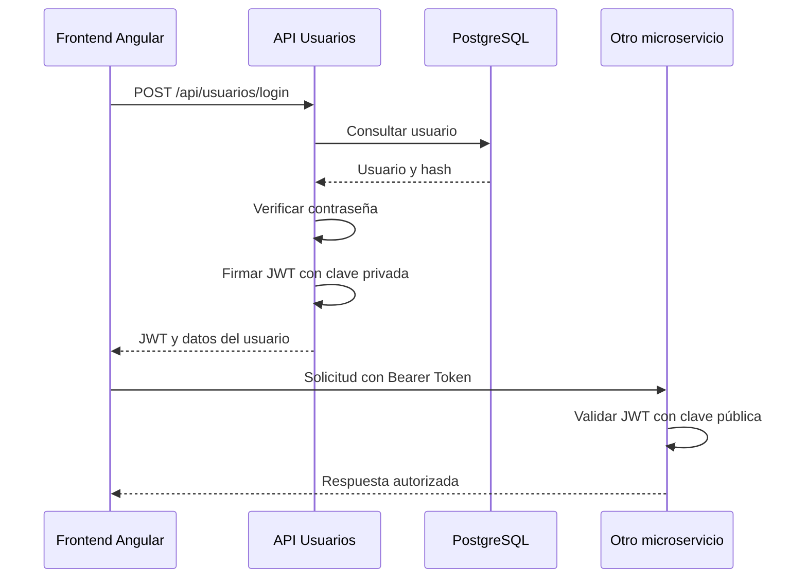

# API Usuarios — Tienda Microservicios

## 1. Descripción

API Usuarios es el microservicio responsable de la gestión de usuarios, autenticación y autorización dentro del proyecto **Tienda Microservicios**, desarrollado para la práctica de Arquitectura de Microservicios Multi-Stack de la asignatura Tópicos Avanzados de Desarrollo Web.

Este servicio permite registrar usuarios, iniciar sesión, consultar perfiles y controlar el acceso a recursos protegidos mediante tokens JWT firmados con el algoritmo RS256.

Cuenta con una base de datos independiente en PostgreSQL y proporciona una API REST que permite la comunicación con el frontend Angular y los demás microservicios del sistema.

## 2. Tecnologías utilizadas

| Tecnología | Propósito |
|---|---|
| PHP 8.5 | Lenguaje de programación del backend |
| Composer | Gestión de dependencias |
| PostgreSQL 16 | Persistencia de usuarios |
| PDO | Comunicación segura con PostgreSQL |
| Firebase PHP-JWT | Generación y validación de tokens JWT |
| RSA 2048 | Generación de claves criptográficas |
| RS256 | Firma y verificación de tokens |
| Docker | Contenerización del microservicio |
| Docker Compose | Integración con los demás servicios |
| Kubernetes | Plataforma prevista para la orquestación |
| Bash y cURL | Pruebas automatizadas |

## 3. Responsabilidades del microservicio

- Registro de nuevos usuarios.
- Validación de credenciales.
- Almacenamiento seguro de contraseñas.
- Generación de tokens JWT.
- Validación de firma, emisor, audiencia y expiración de tokens.
- Consulta de perfiles autenticados.
- Autorización mediante roles.
- Creación controlada de administradores.
- Verificación del estado y disponibilidad del servicio.

API Usuarios no administra productos, pedidos, inventario, pagos ni envíos. Cada una de estas responsabilidades corresponde a un microservicio independiente.

## 4. Arquitectura

El microservicio utiliza una estructura modular que separa las responsabilidades de acceso a datos, lógica de negocio, autenticación, controladores y rutas.

```text
api-usuarios/
├── database/
│   └── 001_crear_usuarios.sql
├── public/
│   └── index.php
├── routes/
│   └── api.php
├── scripts/
│   ├── crear_admin.php
│   └── migrate.php
├── src/
│   ├── Config/
│   │   └── Database.php
│   ├── Controllers/
│   │   └── UsuarioController.php
│   ├── Middleware/
│   │   └── AuthMiddleware.php
│   ├── Models/
│   │   └── Usuario.php
│   ├── Services/
│   │   ├── AuthService.php
│   │   └── JwtService.php
│   └── Utils/
│       └── Response.php
├── tests/
│   └── pruebas.sh
├── .dockerignore
├── composer.json
├── composer.lock
├── Dockerfile
└── README.md
```

### 4.1. Descripción de los componentes

| Archivo | Responsabilidad |
|---|---|
| public/index.php | Punto de entrada de las solicitudes HTTP |
| routes/api.php | Definición y distribución de rutas |
| Database.php | Configuración de la conexión PDO |
| UsuarioController.php | Procesamiento de solicitudes relacionadas con usuarios |
| Usuario.php | Consultas y operaciones sobre la base de datos |
| AuthService.php | Lógica de registro y autenticación |
| JwtService.php | Generación y validación de tokens JWT |
| AuthMiddleware.php | Protección de rutas y control de acceso |
| Response.php | Estandarización de respuestas JSON |
| migrate.php | Ejecución de la migración de base de datos |
| crear_admin.php | Creación de administradores mediante CLI |
| pruebas.sh | Ejecución de pruebas automatizadas |
| Dockerfile | Construcción de la imagen del microservicio |

## 5. Base de datos

El microservicio utiliza una base de datos PostgreSQL independiente.

| Parámetro | Valor |
|---|---|
| Motor | PostgreSQL 16 |
| Base de datos | usuarios_db |
| Usuario de aplicación | usuarios_app |
| Host interno Docker | postgres |
| Puerto interno | 5432 |
| Puerto publicado en desarrollo | 5433 |
| Tabla principal | usuarios |

Las credenciales se administran mediante variables de entorno y no se almacenan directamente en el código fuente.

### 5.1. Tabla usuarios

| Campo | Tipo | Descripción |
|---|---|---|
| id | BIGINT | Identificador único autogenerado |
| nombre | VARCHAR(150) | Nombre del usuario |
| correo | VARCHAR(255) | Correo electrónico único |
| contrasena_hash | VARCHAR(255) | Hash de la contraseña |
| rol | VARCHAR(20) | cliente o admin |
| activo | BOOLEAN | Estado de la cuenta |
| creado_en | TIMESTAMPTZ | Fecha de creación |
| actualizado_en | TIMESTAMPTZ | Fecha de última actualización |

### 5.2. Reglas de integridad

- El correo electrónico debe ser único.
- Los correos se normalizan a minúsculas.
- El nombre no puede estar vacío.
- Los roles permitidos son `cliente` y `admin`.
- Los usuarios registrados públicamente reciben el rol `cliente`.
- Las contraseñas nunca se almacenan en texto plano.
- La fecha de actualización se administra mediante un trigger de PostgreSQL.

### 5.3. Independencia de datos

API Usuarios es propietario de su base de datos.

Los demás microservicios deben consultar la información de usuarios mediante la API REST cuando sea necesario, evitando acceder directamente a sus tablas.

Los identificadores de usuarios pueden utilizarse como referencias lógicas en otros microservicios, sin establecer claves foráneas entre bases de datos independientes.

## 6. Configuración del entorno

El microservicio utiliza las siguientes variables de entorno:

| Variable | Descripción |
|---|---|
| DB_HOST | Host de PostgreSQL |
| DB_PORT | Puerto de PostgreSQL |
| DB_NAME | Nombre de la base de datos |
| DB_USER | Usuario de conexión |
| DB_PASSWORD | Contraseña de conexión |
| JWT_ISSUER | Emisor de los tokens |
| JWT_AUDIENCE | Audiencia autorizada |
| JWT_TTL_SECONDS | Tiempo de vida del token |
| JWT_PRIVATE_KEY_PATH | Ruta de la clave privada RSA |
| JWT_PUBLIC_KEY_PATH | Ruta de la clave pública RSA |

Configuración utilizada dentro de Docker Compose:

```env
DB_HOST=postgres
DB_PORT=5432
DB_NAME=usuarios_db
DB_USER=usuarios_app
DB_PASSWORD=CONFIGURAR_PASSWORD

JWT_ISSUER=api-usuarios
JWT_AUDIENCE=tienda-microservicios
JWT_TTL_SECONDS=3600

JWT_PRIVATE_KEY_PATH=/run/secrets/jwt_private.pem
JWT_PUBLIC_KEY_PATH=/run/secrets/jwt_public.pem
```

Las variables de conexión se obtienen del archivo `.env` ubicado en la raíz del proyecto.

El archivo `.env.example` contiene la plantilla de configuración necesaria para preparar un entorno de desarrollo.

No se deben publicar contraseñas reales, archivos `.env` ni claves privadas en GitHub.

## 7. Generación de claves RSA

El sistema utiliza un par de claves RSA de 2048 bits para la firma y validación de tokens.

Desde la raíz del proyecto:

```bash
mkdir -p secrets
```

Generar la clave privada:

```bash
openssl genpkey \
  -algorithm RSA \
  -out secrets/jwt_private.pem \
  -pkeyopt rsa_keygen_bits:2048
```

Generar la clave pública:

```bash
openssl pkey \
  -in secrets/jwt_private.pem \
  -pubout \
  -out secrets/jwt_public.pem
```

Configurar permisos:

```bash
chmod 600 secrets/jwt_private.pem
chmod 644 secrets/jwt_public.pem
```

En sistemas WSL con archivos almacenados en unidades de Windows, los permisos efectivos también dependen de la configuración del sistema de archivos.

Estas claves deben generarse únicamente al preparar un entorno que todavía no cuenta con ellas. Regenerarlas invalidará los tokens emitidos anteriormente.

### Distribución de claves

- La clave privada pertenece exclusivamente a API Usuarios.
- La clave pública puede distribuirse a los demás microservicios.
- El frontend no necesita ninguna de las dos claves.
- Las claves se montan en los contenedores mediante archivos de solo lectura.
- Todos los microservicios de un mismo entorno deben utilizar la clave pública correspondiente a la clave privada de API Usuarios.

## 8. Instalación y ejecución

Los siguientes comandos deben ejecutarse desde la raíz del repositorio `tienda-microservicios`.

### 8.1. Requisitos

- Docker.
- Docker Compose.
- Git.
- OpenSSL.
- Bash.
- cURL.
- Python 3 para ejecutar las pruebas automatizadas.
- Archivo `.env` configurado.
- Claves RSA generadas.

### 8.2. Construir la imagen

```bash
docker compose build api-usuarios
```

### 8.3. Iniciar el microservicio

```bash
docker compose up -d api-usuarios
```

Docker Compose iniciará las dependencias necesarias, incluyendo PostgreSQL.

### 8.4. Ejecutar la migración

```bash
docker compose exec -T api-usuarios php scripts/migrate.php
```

Este comando prepara la tabla `usuarios` y sus restricciones.

### 8.5. Verificar los contenedores

```bash
docker compose ps
```

### 8.6. Consultar los registros

```bash
docker compose logs -f api-usuarios
```

### 8.7. Direcciones del servicio

Desde el equipo anfitrión:

```text
http://localhost:8001
```

Desde otros contenedores de la red Docker:

```text
http://api-usuarios:8001
```

La imagen generada se identifica como:

```text
tienda/api-usuarios:1.0.0
```

## 9. Documentación de endpoints

Todos los endpoints utilizan HTTP y respuestas en formato JSON.

### 9.1. Resumen

| Método | Endpoint | Acceso |
|---|---|---|
| GET | /health | Público |
| GET | /ready | Público |
| POST | /api/usuarios/registro | Público |
| POST | /api/usuarios/login | Público |
| GET | /api/usuarios/me | Autenticado |
| GET | /api/usuarios/{id} | Propietario o administrador |

### 9.2. Health Check

**GET /health**

Comprueba que el proceso del microservicio está funcionando.

```bash
curl -i http://localhost:8001/health
```

Respuesta HTTP 200:

```json
{
  "status": "ok",
  "servicio": "api-usuarios"
}
```

### 9.3. Readiness Check

**GET /ready**

Comprueba que el microservicio está preparado para recibir solicitudes.

```bash
curl -i http://localhost:8001/ready
```

Respuesta HTTP 200:

```json
{
  "status": "ready",
  "servicio": "api-usuarios"
}
```

Si el servicio no está preparado, debe responder HTTP 503.

Estos endpoints permiten implementar comprobaciones de disponibilidad en Docker y posteriormente en Kubernetes.

### 9.4. Registro de usuario

**POST /api/usuarios/registro**

Permite registrar un nuevo cliente.

Cuerpo de la solicitud:

```json
{
  "nombre": "Usuario de prueba",
  "correo": "cliente@tienda.test",
  "contrasena": "Tienda123!"
}
```

Ejemplo con cURL:

```bash
curl -i -X POST \
  http://localhost:8001/api/usuarios/registro \
  -H "Content-Type: application/json" \
  -d '{
    "nombre":"Usuario de prueba",
    "correo":"cliente@tienda.test",
    "contrasena":"Tienda123!"
  }'
```

Respuesta HTTP 201:

```json
{
  "mensaje": "Usuario registrado correctamente",
  "datos": {
    "id": 1,
    "nombre": "Usuario de prueba",
    "correo": "cliente@tienda.test",
    "rol": "cliente",
    "activo": true,
    "creado_en": "2026-11-27T03:55:03Z"
  }
}
```

Validaciones:

- Nombre obligatorio.
- Correo electrónico válido y único.
- Contraseña de al menos ocho caracteres.
- Asignación automática del rol `cliente`.
- Almacenamiento de la contraseña mediante hash.

Si el cliente intenta enviar `"rol": "admin"` durante el registro, no obtiene privilegios administrativos.

### 9.5. Inicio de sesión

**POST /api/usuarios/login**

Valida las credenciales y genera un token JWT.

Cuerpo de la solicitud:

```json
{
  "correo": "cliente@tienda.test",
  "contrasena": "Tienda123!"
}
```

Ejemplo:

```bash
curl -i -X POST \
  http://localhost:8001/api/usuarios/login \
  -H "Content-Type: application/json" \
  -d '{
    "correo":"cliente@tienda.test",
    "contrasena":"Tienda123!"
  }'
```

Respuesta HTTP 200:

```json
{
  "mensaje": "Inicio de sesion exitoso",
  "datos": {
    "token": "TOKEN_JWT_GENERADO",
    "tipo_token": "Bearer",
    "expira_en": 3600,
    "usuario": {
      "id": 1,
      "nombre": "Usuario de prueba",
      "correo": "cliente@tienda.test",
      "rol": "cliente"
    }
  }
}
```

El token tiene una duración de 3600 segundos, equivalente a una hora.

Si las credenciales son incorrectas, el servicio responde HTTP 401.

### 9.6. Consultar perfil autenticado

**GET /api/usuarios/me**

Devuelve la información del usuario identificado mediante el token JWT.

Encabezado requerido:

```http
Authorization: Bearer TOKEN_JWT
```

Ejemplo:

```bash
curl -i http://localhost:8001/api/usuarios/me \
  -H "Authorization: Bearer $TOKEN"
```

Respuesta HTTP 200:

```json
{
  "mensaje": "Perfil obtenido correctamente",
  "datos": {
    "id": 1,
    "nombre": "Usuario de prueba",
    "correo": "cliente@tienda.test",
    "rol": "cliente",
    "activo": true
  }
}
```

Este endpoint permite al frontend verificar la sesión y recuperar la información del usuario autenticado.

### 9.7. Consultar usuario por identificador

**GET /api/usuarios/{id}**

Permite consultar un usuario mediante su identificador.

Reglas de acceso:

- Un cliente únicamente puede consultar su propio perfil.
- Un administrador puede consultar otros usuarios.
- Un usuario sin token válido no puede acceder.

Ejemplo:

```bash
curl -i http://localhost:8001/api/usuarios/1 \
  -H "Authorization: Bearer $TOKEN"
```

Respuesta HTTP 200:

```json
{
  "mensaje": "Usuario obtenido correctamente",
  "datos": {
    "id": 1,
    "nombre": "Usuario de prueba",
    "correo": "cliente@tienda.test",
    "rol": "cliente",
    "activo": true,
    "creado_en": "2026-11-27T03:55:03Z"
  }
}
```

Si el usuario intenta consultar un perfil para el que no tiene autorización, recibe HTTP 403.

Si el usuario solicitado no existe y la solicitud está autorizada, recibe HTTP 404.

## 10. Autenticación mediante JWT

El sistema utiliza JSON Web Tokens para implementar autenticación distribuida entre microservicios.

JWT permite transmitir información verificable sobre la identidad del usuario sin compartir su contraseña con los demás servicios.

### 10.1. Estructura del token

Un JWT está compuesto por tres partes:

```text
HEADER.PAYLOAD.SIGNATURE
```

- Header: identifica el tipo de token y el algoritmo utilizado.
- Payload: contiene las declaraciones o claims del usuario.
- Signature: permite verificar la autenticidad e integridad del token.

### 10.2. Algoritmo RS256

RS256 utiliza criptografía asimétrica.

API Usuarios firma los tokens utilizando la clave privada RSA. Los demás microservicios pueden verificar la firma mediante la clave pública sin tener acceso a la clave privada.

Esto permite centralizar la emisión de tokens y distribuir su validación.

### 10.3. Claims utilizados

Ejemplo ilustrativo del contenido de un token:

```json
{
  "iss": "api-usuarios",
  "aud": "tienda-microservicios",
  "sub": "1",
  "rol": "cliente",
  "iat": 1795752000,
  "exp": 1795755600
}
```

| Claim | Descripción |
|---|---|
| iss | Emisor del token |
| aud | Audiencia autorizada |
| sub | Identificador del usuario como cadena |
| rol | Rol asignado al usuario |
| iat | Fecha de emisión |
| exp | Fecha de expiración |

El contenido de un JWT firmado puede decodificarse, pero no puede modificarse sin invalidar su firma.

Por esta razón, el token no contiene contraseñas, hashes de contraseñas ni información confidencial innecesaria.

### 10.4. Flujo de autenticación



### 10.5. Validación en otros microservicios

Los servicios que reciben solicitudes autenticadas deben verificar:

1. Presencia del encabezado Authorization.
2. Formato Bearer.
3. Firma criptográfica válida.
4. Algoritmo RS256.
5. Emisor `api-usuarios`.
6. Audiencia `tienda-microservicios`.
7. Fecha de expiración.
8. Identificador válido del usuario.
9. Rol permitido.
10. Permisos sobre el recurso solicitado.

No es suficiente decodificar el contenido del JWT. Es obligatorio verificar su firma y sus claims antes de confiar en la información.

## 11. Roles y autorización

El sistema cuenta con dos roles principales.

| Permiso | Cliente | Administrador |
|---|---|---|
| Iniciar sesión | Sí | Sí |
| Consultar perfil propio | Sí | Sí |
| Consultar otros usuarios | No | Sí |
| Acceder a operaciones administrativas | No | Según permisos de cada servicio |
| Obtener rol admin mediante registro público | No | No |

La autenticación verifica la identidad del usuario, mientras que la autorización determina las operaciones que puede realizar.

## 12. Creación de administradores

Por seguridad, no existe un endpoint público para registrar administradores.

Los administradores se crean mediante un script de línea de comandos.

Desde la raíz del proyecto:

```bash
docker compose exec api-usuarios php scripts/crear_admin.php
```

El programa solicita:

```text
=== CREACION DE ADMINISTRADOR ===
Nombre:
Correo:
Contrasena:
```

Ejemplo de resultado:

```json
{
  "id": 3,
  "nombre": "Administrador Tienda",
  "correo": "admin@tienda.test",
  "rol": "admin"
}
```

El script valida los datos, genera el hash de la contraseña y almacena el usuario con el rol correspondiente.

La contraseña del administrador debe definirse individualmente en cada entorno y no debe publicarse en el repositorio.

## 13. Seguridad implementada

El microservicio incorpora los siguientes mecanismos de seguridad:

- Hash de contraseñas mediante bcrypt.
- Verificación de contraseñas mediante `password_verify`.
- Consultas preparadas mediante PDO.
- Validación de datos de entrada.
- Restricción de correos duplicados.
- Firma de tokens JWT mediante RS256.
- Validación de firma criptográfica.
- Validación de emisor y audiencia.
- Expiración de tokens.
- Control de acceso mediante roles.
- Restricción de acceso a perfiles de otros usuarios.
- Prevención de escalamiento de privilegios mediante el registro público.
- Separación de claves públicas y privadas.
- Exclusión de credenciales del control de versiones.
- Respuestas que no incluyen hashes de contraseñas.
- Base de datos independiente con credenciales propias.

## 14. Formato de respuestas

Las respuestas exitosas de los endpoints de negocio utilizan la siguiente estructura:

```json
{
  "mensaje": "Operacion realizada correctamente",
  "datos": {}
}
```

Las respuestas de error utilizan:

```json
{
  "error": {
    "codigo": "CODIGO_ERROR",
    "mensaje": "Descripcion del error"
  }
}
```

Ejemplo de token inválido:

```json
{
  "error": {
    "codigo": "TOKEN_INVALIDO",
    "mensaje": "El token es inválido o ha expirado"
  }
}
```

Ejemplo de usuario inexistente:

```json
{
  "error": {
    "codigo": "USUARIO_NO_ENCONTRADO",
    "mensaje": "El usuario no existe"
  }
}
```

Los endpoints `/health` y `/ready` utilizan una estructura independiente para facilitar las comprobaciones de infraestructura.

### Códigos HTTP

| Código | Significado |
|---|---|
| 200 | Operación exitosa |
| 201 | Recurso creado |
| 400 | Solicitud inválida |
| 401 | Credenciales o token inválido |
| 403 | Acceso no autorizado al recurso |
| 404 | Recurso inexistente |
| 405 | Método HTTP no permitido |
| 409 | Conflicto de datos |
| 500 | Error interno del servidor |
| 503 | Servicio no disponible |

## 15. Integración con el frontend Angular

El frontend debe consumir los endpoints definidos en los contratos generales del proyecto.

Durante el desarrollo individual puede utilizarse:

```text
http://localhost:8001
```

En la integración general se utilizarán rutas relativas mediante el proxy del frontend:

```text
/api/usuarios/registro
/api/usuarios/login
/api/usuarios/me
```

El navegador no debe utilizar directamente el nombre interno `api-usuarios`, ya que este pertenece a la red de contenedores.

### 15.1. Registro

El formulario debe enviar:

```json
{
  "nombre": "Nombre del usuario",
  "correo": "usuario@ejemplo.com",
  "contrasena": "Password123!"
}
```

### 15.2. Inicio de sesión

El frontend debe enviar el correo y la contraseña al endpoint de login.

Una vez recibida la respuesta, debe obtener:

```typescript
respuesta.datos.token
respuesta.datos.usuario
respuesta.datos.expira_en
```

### 15.3. Solicitudes protegidas

Las solicitudes que requieren autenticación deben incluir:

```http
Authorization: Bearer TOKEN_JWT
```

Se recomienda implementar un interceptor HTTP en Angular para agregar automáticamente este encabezado a las solicitudes protegidas.

### 15.4. Interfaces sugeridas

```typescript
export interface Usuario {
  id: number;
  nombre: string;
  correo: string;
  rol: 'cliente' | 'admin';
  activo?: boolean;
  creado_en?: string;
}

export interface LoginResponse {
  mensaje: string;
  datos: {
    token: string;
    tipo_token: string;
    expira_en: number;
    usuario: Usuario;
  };
}
```

### 15.5. Administración de sesión

- Mantener preferentemente el token en memoria.
- Utilizar guards para proteger rutas privadas.
- Consultar `/api/usuarios/me` para recuperar el perfil.
- Redirigir al inicio de sesión cuando el token expire.
- Eliminar el token y los datos de sesión al cerrar sesión.
- No almacenar contraseñas en el navegador.
- No incluir claves RSA privadas ni tokens internos en el frontend.

El cierre de sesión elimina el token del cliente, pero no revoca automáticamente un JWT previamente emitido. Este permanece válido hasta su expiración.

Los guards del frontend mejoran la navegación, pero no sustituyen las validaciones de autorización del backend.

## 16. Integración con otros microservicios

API Usuarios proporciona la identidad utilizada por los demás servicios del sistema.

| Microservicio | Uso de la autenticación |
|---|---|
| API Productos | Validación de operaciones administrativas |
| API Envíos | Identificación y autorización en operaciones protegidas |
| API Inventario | Validación de operaciones administrativas |
| API Carrito | Identificación del propietario del carrito |
| API Pedidos | Identificación del propietario de los pedidos |
| API Pagos | Autorización de consultas de pagos |
| API Reseñas | Identificación del autor de una reseña |

Cada servicio puede validar los tokens de forma independiente utilizando la clave pública RSA.

Las operaciones internas entre microservicios deben utilizar los mecanismos de autenticación interna definidos en la arquitectura general del proyecto.

## 17. Pruebas manuales

Se realizaron 19 pruebas manuales para verificar el funcionamiento, la autenticación y la autorización del microservicio.

| ID | Prueba | Resultado |
|---|---|---|
| P01 | Registro de usuario | Aprobada |
| P02 | Almacenamiento seguro de contraseña | Aprobada |
| P03 | Registro con correo duplicado | Aprobada |
| P04 | Registro con contraseña inválida | Aprobada |
| P05 | Inicio de sesión y generación de JWT | Aprobada |
| P06 | Verificación del algoritmo y duración del JWT | Aprobada |
| P07 | Consulta de perfil autenticado | Aprobada |
| P08 | Consulta de perfil propio mediante ID | Aprobada |
| P09 | Acceso sin token | Aprobada |
| P10 | Acceso con token inválido | Aprobada |
| P11 | Inicio de sesión con contraseña incorrecta | Aprobada |
| P12 | Acceso a otro usuario sin autorización | Aprobada |
| P13 | Intento de registro público como administrador | Aprobada |
| P14 | Manipulación del contenido del JWT | Aprobada |
| P15 | Inicio de sesión como administrador | Aprobada |
| P16 | Administrador consultando otro usuario | Aprobada |
| P17 | Consulta de usuario inexistente | Aprobada |
| P18 | Rechazo de token expirado | Aprobada |
| P19 | Rechazo de token con audiencia incorrecta | Aprobada |

Resultado: **19 de 19 pruebas aprobadas.**

## 18. Pruebas automatizadas

El archivo `tests/pruebas.sh` contiene un conjunto de pruebas automatizadas utilizando Bash, cURL y Python.

Para ejecutarlas, desde la raíz del proyecto:

```bash
bash api-usuarios/tests/pruebas.sh
```

En caso de problemas con los saltos de línea de Windows:

```bash
sed -i 's/\r$//' api-usuarios/tests/pruebas.sh
```

Validar la sintaxis:

```bash
bash -n api-usuarios/tests/pruebas.sh
```

### Resultados obtenidos

```text
======================================
 PRUEBAS AUTOMATIZADAS API USUARIOS
======================================
[OK] Health check - HTTP 200
[OK] Readiness check - HTTP 200
[OK] Registro de usuario - HTTP 201
[OK] Correo duplicado - HTTP 409
[OK] Contrasena invalida - HTTP 400
[OK] Inicio de sesion - HTTP 200
[OK] Perfil autenticado - HTTP 200
[OK] Perfil propio por ID - HTTP 200
[OK] Acceso sin token - HTTP 401
[OK] Token invalido - HTTP 401
[OK] Contrasena incorrecta - HTTP 401
[OK] Registro con intento de rol admin - HTTP 201
[OK] Registro publico sin privilegios
[OK] Acceso a otro usuario - HTTP 403
[OK] JWT manipulado - HTTP 401
[OK] JSON invalido - HTTP 400
[OK] Ruta inexistente - HTTP 404
[OK] Metodo no permitido - HTTP 405

======================================
RESULTADOS
Pruebas aprobadas: 18
Pruebas fallidas: 0
======================================
```

### Resumen general

| Tipo de prueba | Ejecutadas | Aprobadas | Fallidas |
|---|---:|---:|---:|
| Manuales | 19 | 19 | 0 |
| Automatizadas | 18 | 18 | 0 |
| Total de comprobaciones | 37 | 37 | 0 |

Se obtuvo un cumplimiento del 100 % de las comprobaciones realizadas. Algunas pruebas automatizadas repiten escenarios evaluados manualmente.

El script genera correos únicos en cada ejecución, por lo que puede ejecutarse repetidamente sin provocar conflictos con usuarios anteriores.

Estas pruebas crean registros en la base de datos y deben ejecutarse exclusivamente en entornos de desarrollo o pruebas.

## 19. Contenerización con Docker

API Usuarios dispone de un Dockerfile independiente que permite construir una imagen reproducible del microservicio.

La imagen incluye:

- PHP 8.5 CLI.
- Extensiones necesarias para PostgreSQL.
- Composer.
- Dependencias del proyecto.
- Código fuente del microservicio.
- Scripts de migración y administración.

El servicio escucha en el puerto 8001 y se comunica con PostgreSQL mediante la red interna `red-tienda`.

La configuración de Docker Compose permite:

- Construir la imagen.
- Iniciar el contenedor.
- Configurar variables de entorno.
- Montar las claves RSA en modo de solo lectura.
- Esperar la disponibilidad de PostgreSQL.
- Verificar el estado del servicio mediante health checks.

## 20. Orquestación mediante Kubernetes

El microservicio está preparado para integrarse en la arquitectura general de Kubernetes del proyecto.

La implementación prevista contempla:

- Namespace `tienda`.
- Deployment independiente para API Usuarios.
- Service para comunicación interna.
- ConfigMaps para configuración no confidencial.
- Secrets para credenciales y claves RSA.
- Liveness Probe mediante `/health`.
- Readiness Probe mediante `/ready`.
- Escalamiento horizontal mediante réplicas.
- Recuperación automática de Pods.

El uso de JWT y la persistencia externa en PostgreSQL permiten que el microservicio no dependa de sesiones almacenadas localmente en un contenedor.

Las réplicas deben utilizar la misma configuración, base de datos y claves criptográficas del entorno.

Los manifiestos y las pruebas de despliegue mediante `kubectl` se documentarán como parte de la integración general de Kubernetes.

## 21. Consideraciones para producción

La implementación corresponde a una práctica académica de arquitectura de microservicios.

Para utilizarla en un entorno de producción se recomienda incorporar:

- HTTPS para proteger credenciales y tokens durante su transmisión.
- Un servidor PHP adecuado para producción.
- Limitación de solicitudes de autenticación.
- Rotación controlada de claves RSA.
- Administración centralizada de secretos.
- Monitoreo y registros centralizados.
- Estrategias de renovación y revocación de tokens.
- Pruebas de carga y concurrencia.
- Políticas de red entre microservicios.

## 22. Documentación relacionada

Los contratos y decisiones generales de arquitectura se encuentran en:

```text
documentacion/arquitectura/
├── ARQUITECTURA.md
├── BASES_DE_DATOS.md
├── CONTRATOS_API.md
├── AUTENTICACION.md
└── FLUJO_COMPRA.md
```

Estos documentos deben consultarse al integrar API Usuarios con los demás componentes del sistema.

## 23. Conclusión

API Usuarios implementa un servicio independiente de autenticación, gestión de usuarios y autorización mediante JWT RS256.

La separación de responsabilidades, el uso de una base de datos propia y la comunicación mediante una API REST permiten mantener el desacoplamiento respecto a los demás componentes.

La utilización de criptografía asimétrica permite centralizar la generación de tokens y distribuir su validación entre los microservicios, sin compartir la clave privada.

Las pruebas manuales y automatizadas realizadas comprobaron el funcionamiento de los endpoints, la persistencia de datos y los mecanismos de seguridad implementados.

Este microservicio constituye la base de autenticación y autorización para la arquitectura Multi-Stack del proyecto Tienda Microservicios.